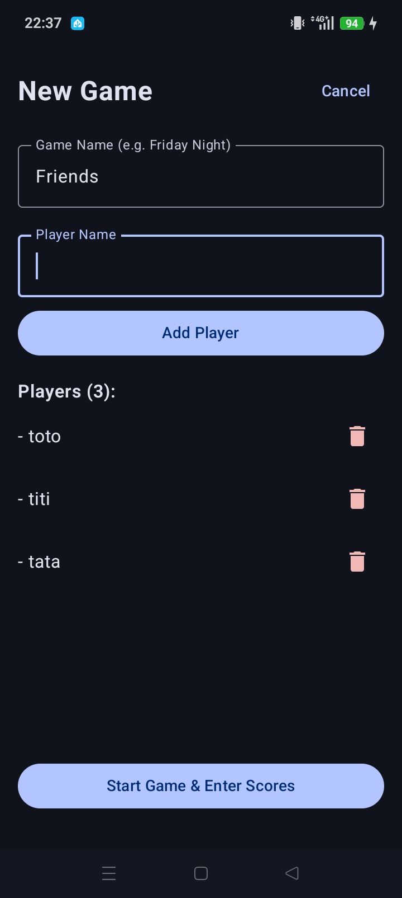
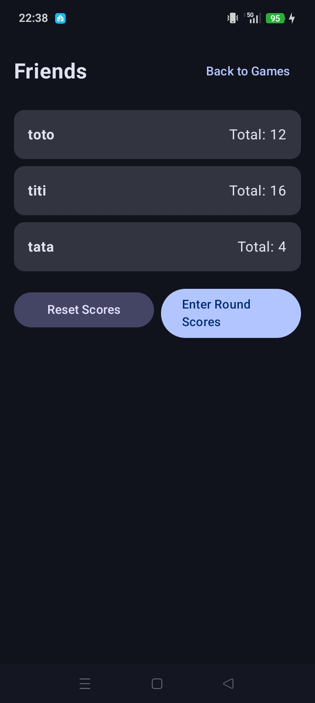
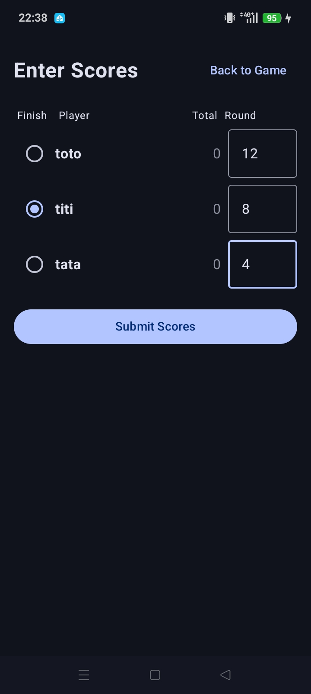
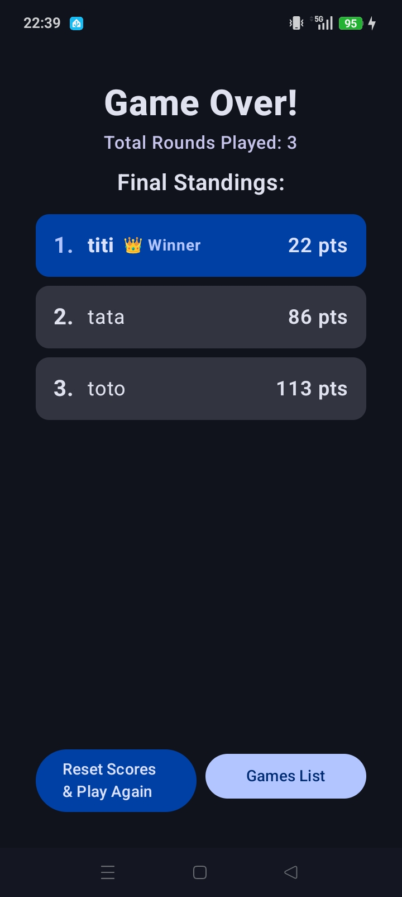

# Introduction

- This is simple Android Application for computing skyjo score.

# Build / deploy
- Use Android Studio for buildidng and deploying this project
- You must enable USB Debugging for installing the application

# Main Page

- Load or Create a new Game
  1 ) Ennter the nalme of the Game
  2 ) Enter Player mane and press add Player button for each Player.
  3 ) Press Start button to enter in the Game End

# Gamee Page 
- THe page display the score of each Players.
- Press Enter Round Game to entering score

# Enterirg Score

- Select the first Finished Player
- Enter score for each Player
- Then Press Submit Scores

# End
- At the end of Game, the application display the ranking

